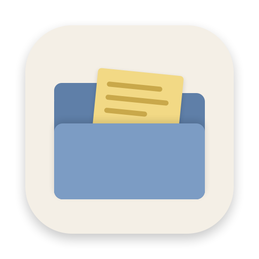
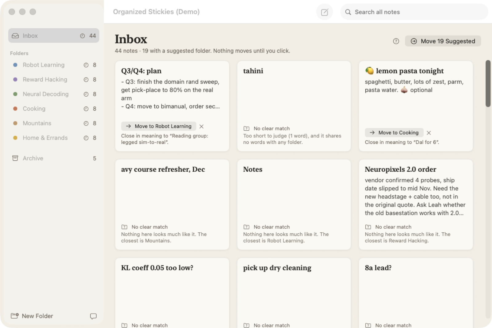
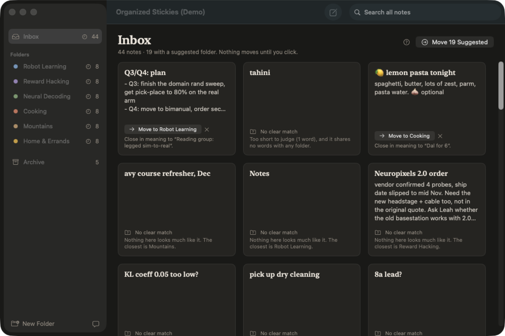
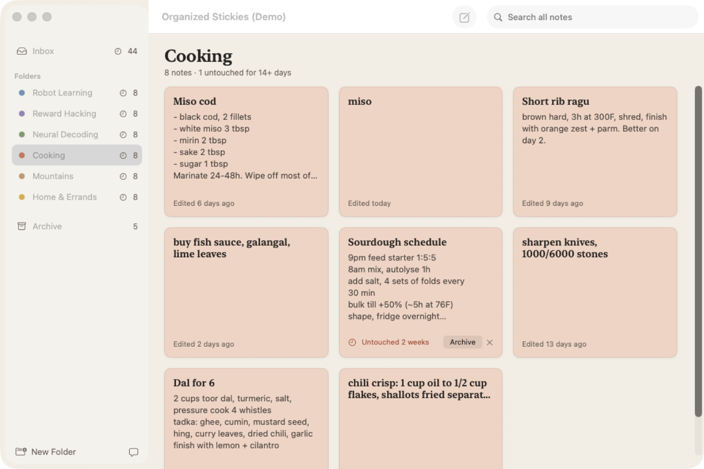

# Organized Stickies

Sticky notes for the Mac that live in folders on one board instead of scattered across your screen. New notes land in an Inbox, and an on-device sorter suggests where each one belongs. It shows why, and it only suggests when it's confident.



<p>


</p>

- **One board, one folder at a time.** Inbox, your folders, Archive. Each note is a plain Markdown file in `~/Documents/Organized Stickies/`.
- **Suggestions, never auto-moves.** On held-out sample notes, all 10 suggestions shown were right, and 9 of 12 longer notes got one ([evaluation](docs/SORTER-EVAL.md)). Short notes usually get "No clear match", by design.
- **Stale notes surface.** Anything untouched for 14 days or more offers **Archive**.
- **Private and free.** Sorting runs on your Mac with Apple's NaturalLanguage framework. No account, no network.
- **Imports Apple Stickies** as copies. The originals aren't changed.

```bash
./scripts/install.sh
```

Requires macOS 26 and Xcode 26.

**Docs:** [Instructions](docs/INSTRUCTIONS.md) · [System design](docs/SYSTEM-DESIGN.md) · [Sorter evaluation](docs/SORTER-EVAL.md) · [File structure](docs/FILE-STRUCTURE.md) · [Prompt log](docs/PROMPTS.md)
