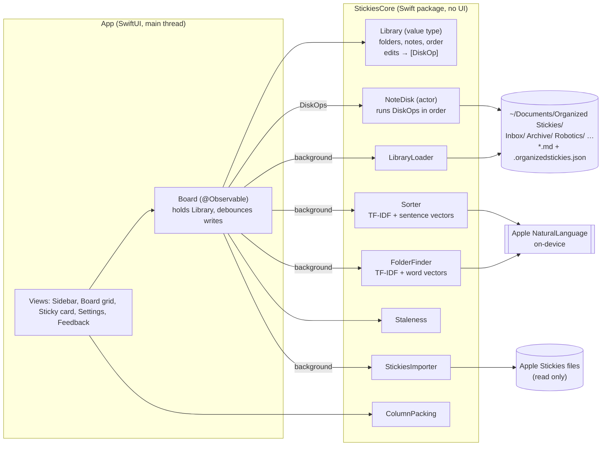

# System Design

Organized Stickies is one Mac window, a backboard of Liquid Glass that lets the desktop show through. Folders sit
in the sidebar, and the chosen folder's notes sit in staggered columns, each
card as tall as its text. Every note is a plain Markdown file in a real Finder
folder. Sorting suggestions run on this Mac.

## Architecture



| Component | Job |
|---|---|
| **Library** | The in-memory truth: folders in order, notes in order, folder colors. Every edit is a `mutating` method that returns the `DiskOp`s needed to make the disk match. It has no I/O, so it's fast and fully unit-testable. |
| **NoteDisk** | An actor that runs `DiskOp`s one at a time, off the main thread: write, rename, move, move to Trash, make or rename a folder, save the index. |
| **LibraryLoader** | Reads the root folder into a `Library`. Creates Inbox and Archive if they're missing. Notes the index doesn't know about (added in Finder) go first, newest first, so you notice them. |
| **Sorter** | Suggests a folder for each Inbox note, or says "No clear match". Explains why. |
| **FolderFinder** | With no folders of your own yet, groups Inbox notes that share words and meaning, and drafts a name for each group. The Inbox offers them as folders to start with. |
| **Staleness** | Decides which notes have been untouched for N days or more. |
| **StickiesImporter** | Copies Apple Stickies' notes (`.rtfd` packages) as plain text. Read only. |
| **ColumnPacking** | Puts cards of different heights into columns, each card into the shortest column so far. Cards keep their column while you work, so moving one out doesn't send the rest hopping. |
| **Board** (app) | Wraps a `Library` for SwiftUI. Applies edits straight away, then sends the disk work to one serial background queue (an `AsyncStream`, so writes, reloads and barriers keep their order). Debounces typing (writes 0.5 s after the last keystroke). Flushes when the app goes to the background, and waits for the queue before quitting. Reloads when the app becomes active. |
| **App shell** | One AppKit `NSWindow` hosting the SwiftUI board, opened by the app delegate. SwiftUI scene windows didn't always open at launch (with `-ApplePersistenceIgnoreState`, which UI tests pass), so the boring AppKit window is used. Settings is a SwiftUI `Settings` scene (⌘,). |

## Main flows

1. **Launch**: show the last snapshot straight away. Then `LibraryLoader` runs in the background and the board is replaced in place, with note IDs kept stable by matching (folder, file name).
2. **Type in a note**: the text changes in memory on every keystroke. After 0.5 s idle, `Library.persist(note)` works out whether the title changed. If it did, it plans a rename, and `NoteDisk` writes the file atomically.
3. **Move or reorder**: drag a card onto a sidebar folder (move), or onto another card (reorder). The UI updates at once; `DiskOp.move` and `saveIndex` follow in the background.
4. **Sort Inbox**: the Board takes a snapshot of the texts, then the Sorter runs on a background task and hands back results a dozen notes at a time, top of the Inbox first. Each card's chip appears as soon as its batch is done: **Move to Robotics**, with a reason line. You accept or dismiss each one. Nothing moves without a click.
5. **Accept**: the card's ghost flies from where it sat to its folder row in the sidebar (300 ms), and the folder's count ticks up as it lands. Only cards on screen fly, and nothing flies with Reduce Motion on. The move itself happens at once; the flight is only a picture of it.
6. **Stale**: a note untouched for N days or more (not in Archive) shows **Archive** with its age. On an Inbox card a folder suggestion comes first (filing beats archiving), but the Archive offer replaces "No clear match". Before 2026-10-29 every Inbox note's sorting result hid the offer, so old notes in the Inbox, where they pile up, never showed it.
7. **Starter folders**: while you have no folders of your own, each sort also runs `FolderFinder` on the Inbox. Groups of 3 or more appear above the cards under **Folders to start with**, each with a draft name you can change, what its notes share, and a few titles. **Make Folder with N Notes** creates the folder and moves the notes in, each card flying to the new row. **×** drops one group; **Not Now** hides them until the app quits.
8. **Import**: in Settings, Import from Apple Stickies copies every note into Inbox, keeping each note's original edit date. IDs already imported are remembered, so running it twice doesn't duplicate notes.

## Where data lives

```
~/Documents/Organized Stickies/
  .organizedstickies.json   ← folder order, colors, note order (small; safe to delete)
  Inbox/
    Call dentist re crown.md
  Archive/
  Robot Learning/
    Sim-to-real checklist.md
```

- A note is its file. Its title is the first non-empty line, and the file name follows the title (made filename-safe, with " 2" added if the name is taken).
- "Untouched" means the file's modification date. Edits made in Finder or another editor count too.
- If the index file is deleted, nothing is lost. Order falls back to newest first, and colors are reassigned.
- Backups: Time Machine already covers `~/Documents`. Delete moves to the Trash, never a hard delete.

## Smart sorting

The sorter gives each user folder (everything except Inbox and Archive) a score for the note:

$$
\text{score}(n, f) = w \cdot \cos\big(\mathbf{t}_n, \mathbf{t}_f\big) + (1-w) \cdot \cos\big(\mathbf{e}_n, \mathbf{e}_f\big)
$$

- $\mathbf{t}_n$: the note's TF-IDF word vector. TF-IDF stands for term frequency × inverse document frequency. It weights a word up when it's frequent in this note and down when it's common across all notes, so "the" counts for nothing and "Neuropixels" counts for a lot.
- $\mathbf{t}_f$: the folder's TF-IDF vector, built from its notes plus its name (the name counts 3×).
- $\mathbf{e}_n, \mathbf{e}_f$: 512-number sentence vectors from Apple's on-device model, for the note and for the average of the folder's notes. These capture meaning: "braise short ribs" sits near "slow-cook lamb shoulder" even with no words in common.
- $\cos$: cosine similarity, from 0 (unrelated) to 1 (same direction).
- $w$: how much word overlap counts versus meaning. It's an estimate tuned on sample data.

**In plain words**: a note goes where its words and its meaning look most like the notes already filed there.

The folder's meaning term blends the folder average and the single closest note: $\cos(\mathbf{e}_n, \mathbf{e}_f) = (1-v)\,\cos(\mathbf{e}_n, \bar{\mathbf{e}}_f) + v \max_{m \in f} \cos(\mathbf{e}_n, \mathbf{e}_m)$, where $v$ is the nearest-note weight.

A suggestion is shown only when the best folder's score clears a **threshold** and is at least a set **ratio** above the runner-up's. Both are estimates fitted on sample notes. With 7 words or fewer, the meaning vector is too noisy to trust, so a short note also needs a keyword hit (a word shared with the folder's name or notes).

**Young folders need a closer match.** A folder with fewer than 7 notes needs a score of 0.33 instead of 0.25. The reason line says so: "Maybe Cooking, but it has only 3 notes, so it needs a closer match."

- *Why*: a few notes say little about a topic. And right after an import, many notes belong to topics that have no folder yet, so they drift to the nearest young folder. In simulated first imports from the sample (25 notes each), once folders had been made, the remaining suggestions were right 49% of the time without the rule. Even when the folders were made by hand with the right notes and names (2–5 each), only 77% were right.
- *Why 7*: folders of 7 or 8 notes are where the sorter was measured above 90%. The sample's folders hold 8, and the leave-one-out cases leave 7. Folders of 2–5 notes were measured well below that, and 6 is untested, so it counts as young.
- *How 0.33 was chosen*: fitted the same way as the sorter. It's the lowest threshold with 90%+ right on imports drawn from the 70 tuning notes (28 of 31 right, from 352 suggestions before). It was then checked on imports drawn from the 22 held-out notes. There, v1.2 made 105 suggestions and every one was wrong; now it makes none. So the bar is met on held-out notes only in the sense that nothing wrong is shown. Full tables: [SORTER-EVAL.md](SORTER-EVAL.md).
- *The cost*: new folders get few suggestions until you've filed a few more notes by hand. Strictness in Settings moves both thresholds together.

**Fitted values (estimates, not facts):** $w = 0.7$, $v = 0.75$, threshold $= 0.25$, ratio $= 1.0$. They were fitted on 70 tuning cases: 22 labelled Inbox notes, plus each of the 48 filed notes taken out of its folder in turn (leave-one-out). They were then checked on 22 held-out Inbox notes. Full table: [SORTER-EVAL.md](SORTER-EVAL.md).

| On the 22 held-out notes | Words + meaning (shipped) | Words only | Meaning only |
|---|---|---|---|
| Suggestions right (precision) | 10/10 | 9/9 | 1/1 |
| Longer notes that got one (coverage) | 9/12 | 8/12 | 1/12 |
| Top guess right if forced to guess | 83% | 89% | 56% |

What this shows: on its own, Apple's meaning model blurs the three research folders together (56%). Word overlap ranks better, but its scores are too small and uneven to threshold cleanly. The blend shows more correct suggestions than either alone. What it doesn't show: 10 out of 10 on 22 notes is consistent with a true precision as low as about 72% (Wilson 95% interval). The notes are invented, and your real notes are the actual test.

**Accepting round after round:** moving notes gives folders more evidence, so new suggestions can appear after **Move N Suggested**. On the whole sample Inbox, round 1 moved 19 notes (19 right) and round 2 moved 4 (3 right): 22 of 23 overall. A wrong move can pull in more, which is one more reason every round is a click.

**What didn't work:** the first version used an absolute margin over the runner-up and tuned only on the 22 Inbox notes. It reached 82% precision on the check set (2 wrong out of 11) and overfit. Switching to a scale-free ratio and adding leave-one-out cases fixed both.

**Streaming, and where the time goes.** Word weights (IDF) need every note's words before any note can be scored, so that part runs first; the meaning vectors, the slow part, then run a dozen notes at a time. A note's answer is the same whichever batch it lands in (tested). Finding each word's dictionary form uses Apple's `NLTagger`; making a tagger costs far more than using one, so taggers are now reused and each note's words are remembered. Measured on 200 notes: 2.4 s with a new tagger per note, 0.19 s reused. Spreading the tagging over cores was slower (2.1 s), because every core needs its own tagger. The first use in a session still loads macOS's language data, so the app warms it up in the background at launch.

## Starter folders

The sorter needs folders with notes in them: it compares each Inbox note with what's already filed. With no folders, it has nothing to compare with, and every card says "Make a folder first". Starter folders give it a start.

**How groups are found.** Agglomerative clustering with average linkage. Every note starts as its own group. The two most similar groups join, again and again, until no two are similar enough (the **join threshold**). Two groups' similarity is the average over every pair of notes across them, so one stray look-alike can't drag a whole group in. Groups of fewer than 3 notes are dropped, since the sorter needs a few examples, and at most 6 are offered, biggest first.

Two notes' similarity mixes the same two signals as the sorter, with one change:

$$
\text{sim}(a, b) = w \cdot \cos\big(\mathbf{t}_a, \mathbf{t}_b\big) + (1-w) \cdot \cos\big(\mathbf{u}_a - \bar{\mathbf{u}}, \mathbf{u}_b - \bar{\mathbf{u}}\big)
$$

- $\mathbf{t}_a$: the note's TF-IDF word vector, as above.
- $\mathbf{u}_a$: the sum of Apple's on-device **word** vectors for the note's words (filler words dropped), scaled to length 1. Not the sentence vector the sorter uses: see below.
- $\bar{\mathbf{u}}$: the average of those vectors over the notes being grouped. Subtracting it is called centering. These vectors all lean the same way, so any two notes look fairly alike; centering leaves what sets each note apart.
- $w$: word weight, fitted at 0.7. Join threshold fitted at 0.1125. Both are estimates.

**In plain words**: notes join a group when, on average, their rare words and their gist match the notes already in it.

**Why word vectors, not the sentence model.** Comparing a note with a whole folder averages away noise; comparing one note with one note doesn't. Measured as AUC (the chance that two notes from the same folder look more alike than two from different folders; 0.5 is a coin flip), on meaning alone Apple's sentence model scored 0.60 on the sample notes, its contextual (transformer) embedding 0.65 and summed word vectors 0.74 (a throwaway probe on 2026-10-29, not in the repo). Mixed with word overlap as shipped, sentence vectors score 0.63 and word vectors 0.73 ([SORTER-EVAL.md](SORTER-EVAL.md)). With the sentence model, the best fit on the tuning pile grouped a third of the notes, and on the held-out pile only 1 of the 4 notes it grouped was right. Apple's on-device language model (Foundation Models) could group and name notes far better, but this Mac reports it as not eligible, so it isn't an option yet.

**Naming.** The group's words that are common inside it and rare elsewhere, nouns first ("Sim", not "whether"), units and time words never ("Cup", "Month"). Written as the notes write it ("PPO", "RM"). Names are drafts: the panel asks you to rename before making the folder.

**How well it does (estimates on invented notes).** Fitted to get at least 90% of grouped notes right on 70 tuning notes, then checked on 22 held-out notes, about the size of a first import:

| | Tuning pile (70) | Held-out pile (22) | Everything (92) |
|---|---|---|---|
| Groups offered | 5 | 2 | 6 |
| Grouped notes right | 93% (28/30) | 5/6 | 90% (37/41) |
| Notes with a home that were grouped | 45% | 33% | 48% |
| Real folders found | 5 of 6 | 2 of 6 | 5 of 6 |

What this shows: the groups it offers are mostly right, and about a third to a half of notes land in one. On a 22-note pile, 5 of 6 right is consistent with a true rate anywhere from about 44% to 97% (Wilson 95% interval), so treat it as a sketch. What it doesn't do: make the sorter take off. In v1.2, once every suggested folder was made, the sorter's suggestions for the notes left in Inbox were mostly wrong: 20–24% right on simulated 25-note imports, and 4 of 8 on the full pile. Notes whose topic has no folder yet get pulled toward the nearest folder that exists. Since 2026-10-29, young folders need a closer match (above), so after a small import those suggestions are almost all held back. They're held back, not made right: you file the rest by hand until folders reach 7 notes. A big import still slips through. There, starter groups of 7 or more notes count as grown, even when they mix topics. On the full 92-note pile, 1 of 9 suggestions into them was right.

**Speed.** 250 notes take about 2.5 s in a release build once language data is loaded (the app loads it at launch), off the main thread. Each group remembers its most similar neighbour, so joining doesn't rescan every pair: about n² work instead of n³.

Why not an LLM? It would be more accurate on short notes, but it costs money, needs a key, and sends note text off the Mac. It's deferred as a swappable `Sorter` implementation.

## Key decisions and trade-offs

| Decision | Why | Cost |
|---|---|---|
| One board window, not floating windows | You chose a container. It fixes clutter directly. | Notes aren't visible over other apps. |
| Plain `.md` files in real folders | Readable without the app, Spotlight, Time Machine. | Renames on title change. External edits only show up when the app becomes active. |
| Color comes from the folder | Color carries meaning (which folder), not decoration. | Apple Stickies' per-note colors are dropped on import. |
| `Library` value type + `DiskOp` list | Logic is testable with no disk. The UI never waits on I/O. | Two places to keep in step (memory and disk), so a reload re-syncs them. |
| Suggest, never auto-move | A wrong automatic move costs more trust than a missed suggestion. | One click per note. |
| Unsandboxed local build | Needs to read Apple Stickies' container and ~/Documents. | Gatekeeper warns on other Macs. Not App Store ready. |
| System serif (New York) + SF | No font downloads or licensing work. | Not exactly Newsreader/Inter (bundling them is a proposal). |
| Liquid Glass window, solid paper cards | You asked for the window to feel part of the desktop. The older frosted materials (NSVisualEffectView) draw as flat grey on macOS 26, so the window is see-through with an `NSGlassEffectView` behind everything. Cards stay solid so text reads the same over any background. | The board's color shifts with what's behind it, and a loud wallpaper makes the board loud. It stays glass when the window isn't in front, unlike most Mac apps. Reduce Transparency gives solid paper. |
| Starter folders only while you have no folders | That's when the sorter has nothing to work with, and the groups are a draft for you to name. | Once you have one folder, unfiled topics get no group suggestions; they wait for a folder you make. |
| Folder suggestion before the stale offer on Inbox cards | Filing a note beats archiving it, and one footer row keeps cards quiet. | An old note with a confident suggestion shows only the suggestion; Archive stays one click away in its menu (⇧⌘E). |
| Columns that keep their cards | Short notes get short cards, with no blank paper. Keeping each card's column stops cards jumping when one leaves. | After many moves, columns can end at different heights. They even out when you switch folders or resize the window. Reading order runs across columns, so the newest note isn't always top-left. |

## Scale and what would change

Sized for today: hundreds of notes, one Mac.

- **~5,000+ notes**: loading every file at launch gets slow (about 1 s). Cache the snapshot and load folders lazily.
- **Sorting**: a meaning vector costs about 15–30 ms per note. Vectors are computed in parallel (one model copy per core) and cached in memory by text, as are each note's words, so only new or edited notes cost anything after the first sort. Measured on 2026-10-26 with the Mac otherwise quiet: 200 Inbox notes against 48 filed ones took 4.4 s the first time (release build), down from 9.1 s single-threaded. On 2026-10-27, with other apps keeping the CPU busy (load average 50–500), the same sort took 9–16 s in both the old and new code, run back to back, so streaming costs nothing in total. Under that load the first dozen suggestions arrived after about 1.7 s. At ~2,000 notes, persist the caches to disk and sort incrementally.
- **Two Macs**: put the root in iCloud Drive, then add a file watcher (FSEvents) and conflict handling (two edits to the same note).
- **Other people / sharing**: needs a sync service and an auth model. Out of scope.

## Testing

- `swift test` in `Core/` runs 55 unit tests: Library planning (create, rename on title change, collisions, move, reorder, trash, folders, import de-duplication), the disk round trip in a temp folder (case-only renames, Trash, external files, bad UTF-8, corrupt index, reload merge that keeps unsaved text), the importer (fixture `.rtfd` packages), staleness, the sorter (unit cases, young folders needing a closer match and saying why, strictness moving both thresholds, the spec's done criterion on the held-out half, streamed batches giving the same answers in order, and batches spreading out over the run), column packing (tall cards, keeping columns when a card leaves, new cards to the shortest column), starter folders (groups by shared words, names with the notes' capitals, units never a name, taken names avoided, too few or blank notes give nothing, sensible groups on the sample) and performance budgets (edits on a 500-note folder < 16 ms, loading 1,000 notes < 1 s, sorting 200 notes < 10 s, starter folders for 250 notes < 10 s in a debug build). The performance tests run one at a time, so two heavy ones don't slow each other past their budgets.
- `swift run sorter-eval` re-fits and re-reports the sorter against baselines, the starter folders against the sample's real folders, and the young-folder threshold on simulated first imports (fitted on tuning notes, checked on held-out ones). It takes about 4 minutes.
- An XCUITest target drives the main flows in demo mode (`-demo` opens a temporary copy of the sample notes): writing a note, accepting suggestions, making and renaming a folder, search, keyboard move, quitting mid-typing (the text survives), Settings and the feedback sheet, making a starter folder from an unsorted Inbox, and an old Inbox note offering Archive. 9 tests.
- A manual review checklist covers feel, smoothness and real data: see `docs/INSTRUCTIONS.md`.
- Launch options for testing and screenshots: `-demo` (temporary sample library), `-demo -unsorted` (every sample note in Inbox, no folders, like a first import), `-root <path>`, `-folder <name>`, `-search <text>`, `-appearance light|dark`.
- UI-test lessons: XCUITest on this setup stalls on `NSPredicate` queries over element labels and titles, so the tests check for elements that appear or disappear (`waitForExistence`) instead.

## Known limits

- Notes are plain text. Formatting and images from Apple Stickies are dropped on import.
- Keyboard: picking a folder moves the keyboard to its notes. Tab reaches the grid only when Keyboard navigation is on in System Settings.
- Meaning-based matching is English only. Other languages rely on word overlap.
- Short notes often get "No clear match". That's by design.
- New folders (fewer than 7 notes) get few suggestions, by design. After a big import, starter folders of 7 or more notes can still draw wrong suggestions.
- VoiceOver reads cards in the notes' order across columns, using sort priorities. That's checked in code, not yet by ear.
- The fly-to-folder animation is checked through logs (each accepted card's ghost starts at the card and aims at the right folder row), not by screen capture: captures of the window took about 5 s each on the busy Mac, and the flight lasts 0.3 s.
- External edits made while the app is in front show up only after you switch away and back.
