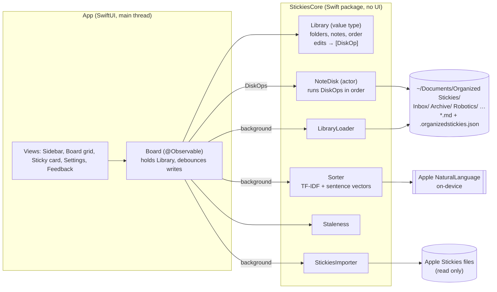

# System Design

Organized Stickies is one Mac window, a backboard. Folders sit in the sidebar,
and the chosen folder's notes sit in a grid. Every note is a plain Markdown
file in a real Finder folder. Sorting suggestions run on this Mac.

## Architecture



| Component | Job |
|---|---|
| **Library** | The in-memory truth: folders in order, notes in order, folder colors. Every edit is a `mutating` method that returns the `DiskOp`s needed to make the disk match. It has no I/O, so it's fast and fully unit-testable. |
| **NoteDisk** | An actor that runs `DiskOp`s one at a time, off the main thread: write, rename, move, move to Trash, make or rename a folder, save the index. |
| **LibraryLoader** | Reads the root folder into a `Library`. Creates Inbox and Archive if they're missing. Notes the index doesn't know about (added in Finder) go first, newest first, so you notice them. |
| **Sorter** | Suggests a folder for each Inbox note, or says "No clear match". Explains why. |
| **Staleness** | Decides which notes have been untouched for N days or more. |
| **StickiesImporter** | Copies Apple Stickies' notes (`.rtfd` packages) as plain text. Read only. |
| **Board** (app) | Wraps a `Library` for SwiftUI. Applies edits straight away, then sends the disk work to one serial background queue (an `AsyncStream`, so writes, reloads and barriers keep their order). Debounces typing (writes 0.5 s after the last keystroke). Flushes when the app goes to the background, and waits for the queue before quitting. Reloads when the app becomes active. |
| **App shell** | One AppKit `NSWindow` hosting the SwiftUI board, opened by the app delegate. SwiftUI scene windows didn't always open at launch (with `-ApplePersistenceIgnoreState`, which UI tests pass), so the boring AppKit window is used. Settings is a SwiftUI `Settings` scene (⌘,). |

## Main flows

1. **Launch**: show the last snapshot straight away. Then `LibraryLoader` runs in the background and the board is replaced in place, with note IDs kept stable by matching (folder, file name).
2. **Type in a note**: the text changes in memory on every keystroke. After 0.5 s idle, `Library.persist(note)` works out whether the title changed. If it did, it plans a rename, and `NoteDisk` writes the file atomically.
3. **Move or reorder**: drag a card onto a sidebar folder (move), or onto another card (reorder). The UI updates at once; `DiskOp.move` and `saveIndex` follow in the background.
4. **Sort Inbox**: the Board takes a snapshot of the texts, then the Sorter runs on a background task. Suggestions appear as small chips on each card: **Move to Robotics**, with a reason line. You accept or dismiss each one. Nothing moves without a click.
5. **Stale**: a note untouched for N days or more (not in Archive) shows **Archive?** with its age.
6. **Import**: in Settings, Import from Apple Stickies copies every note into Inbox, keeping each note's original edit date. IDs already imported are remembered, so running it twice doesn't duplicate notes.

## Where data lives

```
~/Documents/Organized Stickies/
  .organizedstickies.json   ← folder order, colors, note order (small; safe to delete)
  Inbox/
    Call dentist re crown.md
  Archive/
  Robot Learning/
    Sim-to-real checklist.md
```

- A note is its file. Its title is the first non-empty line, and the file name follows the title (made filename-safe, with " 2" added if the name is taken).
- "Untouched" means the file's modification date. Edits made in Finder or another editor count too.
- If the index file is deleted, nothing is lost. Order falls back to newest first, and colors are reassigned.
- Backups: Time Machine already covers `~/Documents`. Delete moves to the Trash, never a hard delete.

## Smart sorting

The sorter gives each user folder (everything except Inbox and Archive) a score for the note:

$$
\text{score}(n, f) = w \cdot \cos\big(\mathbf{t}_n, \mathbf{t}_f\big) + (1-w) \cdot \cos\big(\mathbf{e}_n, \mathbf{e}_f\big)
$$

- $\mathbf{t}_n$: the note's TF-IDF word vector. TF-IDF stands for term frequency × inverse document frequency. It weights a word up when it's frequent in this note and down when it's common across all notes, so "the" counts for nothing and "Neuropixels" counts for a lot.
- $\mathbf{t}_f$: the folder's TF-IDF vector, built from its notes plus its name (the name counts 3×).
- $\mathbf{e}_n, \mathbf{e}_f$: 512-number sentence vectors from Apple's on-device model, for the note and for the average of the folder's notes. These capture meaning: "braise short ribs" sits near "slow-cook lamb shoulder" even with no words in common.
- $\cos$: cosine similarity, from 0 (unrelated) to 1 (same direction).
- $w$: how much word overlap counts versus meaning. It's an estimate tuned on sample data.

**In plain words**: a note goes where its words and its meaning look most like the notes already filed there.

The folder's meaning term blends the folder average and the single closest note: $\cos(\mathbf{e}_n, \mathbf{e}_f) = (1-v)\,\cos(\mathbf{e}_n, \bar{\mathbf{e}}_f) + v \max_{m \in f} \cos(\mathbf{e}_n, \mathbf{e}_m)$, where $v$ is the nearest-note weight.

A suggestion is shown only when the best folder's score clears a **threshold** and is at least a set **ratio** above the runner-up's. Both are estimates fitted on sample notes. With 7 words or fewer, the meaning vector is too noisy to trust, so a short note also needs a keyword hit (a word shared with the folder's name or notes).

**Fitted values (estimates, not facts):** $w = 0.7$, $v = 0.75$, threshold $= 0.25$, ratio $= 1.0$. They were fitted on 70 tuning cases: 22 labelled Inbox notes, plus each of the 48 filed notes taken out of its folder in turn (leave-one-out). They were then checked on 22 held-out Inbox notes. Full table: [SORTER-EVAL.md](SORTER-EVAL.md).

| On the 22 held-out notes | Words + meaning (shipped) | Words only | Meaning only |
|---|---|---|---|
| Suggestions right (precision) | 10/10 | 9/9 | 1/1 |
| Longer notes that got one (coverage) | 9/12 | 8/12 | 1/12 |
| Top guess right if forced to guess | 83% | 89% | 56% |

What this shows: on its own, Apple's meaning model blurs the three research folders together (56%). Word overlap ranks better, but its scores are too small and uneven to threshold cleanly. The blend shows more correct suggestions than either alone. What it doesn't show: 10 out of 10 on 22 notes is consistent with a true precision as low as about 72% (Wilson 95% interval). The notes are invented, and your real notes are the actual test.

**Accepting round after round:** moving notes gives folders more evidence, so new suggestions can appear after **Move N Suggested**. On the whole sample Inbox, round 1 moved 19 notes (19 right) and round 2 moved 4 (3 right): 22 of 23 overall. A wrong move can pull in more, which is one more reason every round is a click.

**What didn't work:** the first version used an absolute margin over the runner-up and tuned only on the 22 Inbox notes. It reached 82% precision on the check set (2 wrong out of 11) and overfit. Switching to a scale-free ratio and adding leave-one-out cases fixed both.

Why not an LLM? It would be more accurate on short notes, but it costs money, needs a key, and sends note text off the Mac. It's deferred as a swappable `Sorter` implementation.

## Key decisions and trade-offs

| Decision | Why | Cost |
|---|---|---|
| One board window, not floating windows | You chose a container. It fixes clutter directly. | Notes aren't visible over other apps. |
| Plain `.md` files in real folders | Readable without the app, Spotlight, Time Machine. | Renames on title change. External edits only show up when the app becomes active. |
| Color comes from the folder | Color carries meaning (which folder), not decoration. | Apple Stickies' per-note colors are dropped on import. |
| `Library` value type + `DiskOp` list | Logic is testable with no disk. The UI never waits on I/O. | Two places to keep in step (memory and disk), so a reload re-syncs them. |
| Suggest, never auto-move | A wrong automatic move costs more trust than a missed suggestion. | One click per note. |
| Unsandboxed local build | Needs to read Apple Stickies' container and ~/Documents. | Gatekeeper warns on other Macs. Not App Store ready. |
| System serif (New York) + SF | No font downloads or licensing work. | Not exactly Newsreader/Inter (bundling them is a proposal). |

## Scale and what would change

Sized for today: hundreds of notes, one Mac.

- **~5,000+ notes**: loading every file at launch gets slow (about 1 s). Cache the snapshot and load folders lazily.
- **Sorting**: a meaning vector costs about 15–30 ms per note. Vectors are computed in parallel (one model copy per core) and cached in memory by text, so only new or edited notes cost anything after the first sort. Measured: 200 Inbox notes against 48 filed ones take 4.4 s the first time (release build), down from 9.1 s single-threaded. At ~2,000 notes, persist the cache to disk and sort incrementally.
- **Two Macs**: put the root in iCloud Drive, then add a file watcher (FSEvents) and conflict handling (two edits to the same note).
- **Other people / sharing**: needs a sync service and an auth model. Out of scope.

## Testing

- `swift test` in `Core/` runs 38 unit tests: Library planning (create, rename on title change, collisions, move, reorder, trash, folders, import de-duplication), the disk round trip in a temp folder (case-only renames, Trash, external files, bad UTF-8, corrupt index, reload merge that keeps unsaved text), the importer (fixture `.rtfd` packages), staleness, the sorter (unit cases, plus the spec's done criterion on the held-out half) and performance budgets (edits on a 500-note folder < 16 ms, loading 1,000 notes < 1 s, sorting 200 notes < 10 s).
- `swift run sorter-eval` re-fits and re-reports the sorter against baselines.
- An XCUITest target drives the main flows in demo mode (`-demo` opens a temporary copy of the sample notes): writing a note, accepting suggestions, making and renaming a folder, search, keyboard move, quitting mid-typing (the text survives), Settings and the feedback sheet. 7 tests.
- A manual review checklist covers feel, smoothness and real data: see `docs/INSTRUCTIONS.md`.
- Launch options for testing and screenshots: `-demo` (temporary sample library), `-root <path>`, `-folder <name>`, `-search <text>`, `-appearance light|dark`.
- UI-test lessons: XCUITest on this setup stalls on `NSPredicate` queries over element labels and titles, so the tests check for elements that appear or disappear (`waitForExistence`) instead.

## Known limits

- Notes are plain text. Formatting and images from Apple Stickies are dropped on import.
- Keyboard: picking a folder moves the keyboard to its notes. Tab reaches the grid only when Keyboard navigation is on in System Settings.
- Meaning-based matching is English only. Other languages rely on word overlap.
- Short notes often get "No clear match". That's by design.
- External edits made while the app is in front show up only after you switch away and back.
